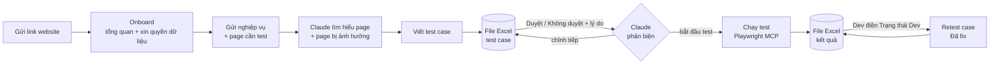

<div align="center">

# 🧪 qa-mcp

**Trợ lý kiểm thử website cho Claude Code: từ onboard dự án, viết test case, review bằng Excel, chạy test bằng Playwright đến retest các bug Dev đã fix.**


</div>

---

## Đây là gì?

`qa-mcp` gồm 2 phần đi cùng nhau:

| Phần | Vai trò |
| --- | --- |
| **MCP server** (`src/`) | Lưu toàn bộ tri thức kiểm thử vào SQLite trên máy: dự án, quyền thao tác dữ liệu, page, nghiệp vụ, test case, lượt test, kết quả, ảnh evidence. Xuất/nạp file Excel. |
| **Skill `qa-tester`** (`skill/qa-tester/`) | Quy trình làm việc cho Claude: onboard dự án, viết test case theo kỹ thuật kiểm thử, phản biện khi bị loại case, chạy test bằng Playwright MCP, báo kết quả, retest. |

Không có web UI. Bạn ra lệnh bằng prompt, review và nhận kết quả bằng **file Excel trong thư mục Downloads**.

## ✨ Tính năng chính

1. **Nhớ dự án lâu dài**: tổng quan nghiệp vụ, page, page liên quan, quyền dữ liệu được phép. Lần sau chỉ cần gọi tên dự án.
2. **Quyền dữ liệu là giới hạn cứng**: Claude hỏi trước được tạo/sửa/xoá/gửi thông báo/thanh toán hay không; case cần quyền bị cấm sẽ ghi `Blocked`, không tự thực hiện.
3. **Review test case bằng Excel**: điền `Duyệt` / `Không duyệt` + lý do; Claude phản biện ngay trong file ở vòng sau.
4. **Chạy test thật bằng Playwright**: chụp ảnh lỗi, log console/network, gắn vào từng kết quả.
5. **File kết quả cho Dev**: ảnh nhúng sẵn, dropdown `Trạng thái Dev`; Dev điền xong gửi lại là retest đúng các case đã fix.
6. **Nạp file an toàn**: kiểm tra đúng dự án/lượt, cột ID ẩn, giá trị hợp lệ; file cũ không ghi đè trạng thái mới hơn; nạp lại cùng file không tạo lượt retest trùng.
7. **Chống phình RAM/ổ đĩa**: nhắc dọn ảnh khi gần 5GB, tự dọn rác Playwright, tắt browser treo.

## 🔄 Quy trình



| Bước | Bạn làm | Claude làm |
| --- | --- | --- |
| 1. Onboard | Gửi link, đăng nhập trên cửa sổ Playwright nếu cần, trả lời câu hỏi quyền dữ liệu | Tìm hiểu tổng quan, tóm tắt để bạn xác nhận, lưu dự án |
| 2–4. Nghiệp vụ | Gửi nội dung nghiệp vụ và page cần test | Tìm hiểu page mới + page cũ có thể bị ảnh hưởng |
| 5. Test case | | Viết case chức năng, edge case, nhập sai, phân quyền, ảnh hưởng page khác, UI |
| 6. Review | Điền file Excel, gửi lại đường dẫn | Nạp file, phản biện hoặc đồng ý loại, xuất file mới |
| 7. Chạy test | Nhắn "bắt đầu test" | Chạy các case đã duyệt, chụp evidence |
| 8. Kết quả | | Xuất file kết quả vào Downloads, tóm tắt case Fail |
| 9. Retest | Gửi lại file Dev đã điền | Retest đúng các case `Đã fix` |

## 🚀 Cài đặt

**Yêu cầu:** Node.js 20+, [Claude Code](https://claude.com/claude-code), Google Chrome.

```bash
git clone https://github.com/buiduclong0511/qa-mcp.git
cd qa-mcp
node scripts/install.mjs
```

Sau đó **khởi động lại Claude Code** và kiểm tra:

```bash
claude mcp list   # qa-mcp và playwright đều ✔ Connected
```

<details>
<summary><b>install.mjs làm những gì?</b></summary>

1. `npm ci` + build TypeScript.
2. Đăng ký 2 MCP ở scope user:
   1. `qa-mcp`.
   2. `playwright`: bản `@playwright/mcp` **ghim trong repo** (không dùng `npx @latest`), một profile dùng chung `~/.qa-mcp/playwright/profile` (đăng nhập một lần), output chung `~/.qa-mcp/playwright/output`, tự đóng browser sau 60 phút không dùng.
3. Link skill vào `~/.claude/skills/qa-tester` (Windows dùng junction, không cần quyền admin).
4. Đặt lịch chạy nền: reaper mỗi 30 phút, dọn rác mỗi ngày 12:30.
   1. macOS: LaunchAgent `local.playwright-reaper`, `local.qa-mcp-cleanup` (plist cũ cùng tên được backup `.bak`).
   2. Windows: Task Scheduler `qa-mcp-playwright-reaper`, `qa-mcp-cleanup` (chạy ẩn).
   3. Linux: in ra 2 dòng để thêm vào `crontab -e`.

Chạy lại nhiều lần vẫn an toàn. Gỡ: `node scripts/install.mjs --uninstall` (giữ nguyên dữ liệu `~/.qa-mcp`).
Nâng cấp Node (đổi đường dẫn `node`) hoặc Playwright MCP thì chạy lại `install.mjs`.

</details>

## 💬 Cách dùng

Chỉ cần nói chuyện với Claude Code:

```text
Tôi muốn test trang https://erp.example.com/sales-warehouse/stock-in-notes
```

```text
Nghiệp vụ: phiếu nhập kho phải có sản phẩm, vị trí, số lượng > 0 ... Test page tạo phiếu và danh sách lô.
```

```text
Đã review xong: ~/Downloads/erp-example-feature1-testcase-20261011-150000.xlsx
```

```text
Bắt đầu test
```

```text
Dev đã cập nhật: ~/Downloads/erp-example-run1-20261011-160000.xlsx, retest giúp tôi
```

Đường dẫn có thể dán kèm dấu nháy, dùng `~` hoặc kéo file từ Finder/Explorer (`file://...`).

## 📊 File Excel

| File | Tạo bởi | Bạn / Dev điền | Nạp lại bằng |
| --- | --- | --- | --- |
| `<dự án>-feature<id>-testcase-<thời gian>.xlsx` | `cases_export` | **Đánh giá** (`Duyệt` / `Không duyệt`), **Lý do**. Case AI đã phản biện để trống ô Đánh giá: chọn `Duyệt` = giữ, `Không duyệt` = loại. Ô trống = không đổi. | `cases_import` |
| `<dự án>-run<id>-<thời gian>.xlsx` | `excel_export` | **Trạng thái Dev** (`Chưa xử lý` / `Đã fix` / `Không phải bug`), **Ghi chú Dev** | `excel_import` |

Cả hai file có cột ID ẩn và sheet `_meta` ẩn để nạp lại đúng dự án/nghiệp vụ/lượt test. Nếu phần mềm khác lưu lại file làm mất `_meta`, hệ thống tự suy ra từ cột ID ẩn.

## 🛠️ Tool MCP

| Nhóm | Tool |
| --- | --- |
| Dự án | `project_list`, `project_get`, `project_upsert`, `policy_set`, `pages_upsert` |
| Nghiệp vụ & test case | `feature_create`, `feature_update`, `feature_get`, `cases_create`, `case_update`, `case_list` |
| Review | `cases_export`, `cases_import`, `review_get`, `case_rebut` |
| Chạy test | `run_create`, `run_get`, `result_record`, `evidence_attach`, `run_finish`, `run_summary` |
| Kết quả & retest | `excel_export`, `excel_import`, `dev_status_set` |
| Dung lượng | `storage_check`, `evidence_cleanup` |

## 🗂️ Dữ liệu

Mặc định ở `~/.qa-mcp/` (đổi bằng biến môi trường `QA_MCP_HOME` trước khi chạy `install.mjs`):

| Đường dẫn | Nội dung |
| --- | --- |
| `qa.db` | SQLite: projects, project_policies, pages, features, test_cases, runs, results, evidence, history |
| `evidence/<dự án>/<lượt>/<TC>/` | Ảnh và log, tên file `NN-stepX-<loại>.<đuôi>` |
| `playwright/profile`, `playwright/output` | Profile và output dùng chung của Playwright MCP |
| `logs/` | Log reaper và dọn rác |
| `config.json` | `storageLimitGb` (5), `warnRatio` (0.9), `staleDays` (60), `thumbnailWidth` (1280), `playwrightWarnGb` (3) |

Không lưu mật khẩu: khi cần đăng nhập, bạn tự đăng nhập trên cửa sổ Playwright. Ảnh evidence chỉ nằm trên máy bạn. Backup: copy cả thư mục `~/.qa-mcp/`.

## 🧹 Chống phình RAM / ổ đĩa

| Vấn đề | Cách xử lý |
| --- | --- |
| Ảnh evidence tích tụ | `storage_check` đầu mỗi phiên; từ 4,5/5GB thì gợi ý nhóm nên dọn (nghiệp vụ đã hết bug mở, lâu không test). Nhóm còn bug mở không bao giờ được gợi ý. Chỉ xoá khi bạn đồng ý; DB giữ lịch sử, Excel ghi "Ảnh đã dọn". |
| Browser treo, MCP mồ côi khi phiên Claude tắt | Reaper tắt browser Playwright mồ côi > 10 phút hoặc sống > 2 giờ mà rảnh, và MCP Playwright mồ côi. Không đụng Chrome cá nhân. |
| Snapshot/ảnh tự sinh của Playwright | Xoá file trong `playwright/output` cũ hơn 3 ngày. |
| Cache profile | Xoá cache khi browser đang tắt, giữ cookie/đăng nhập. |
| Bản `npx @playwright/mcp` cũ, thư mục tạm | Xoá phần không còn tiến trình nào dùng. |
| Bản browser cũ, profile cũ theo từng thư mục | Chỉ khi chạy tay với `--prune-browsers` / `--purge-legacy-profiles`. |

```bash
node dist/maintenance/cli.js cleanup --dry-run      # xem trước
node dist/maintenance/cli.js cleanup --prune-browsers --purge-legacy-profiles
node dist/maintenance/cli.js reaper --dry-run
```

## 🧱 Cấu trúc repo

```text
qa-mcp/
├── src/
│   ├── index.ts          # MCP server (stdio)
│   ├── tools/            # Đăng ký tool MCP
│   ├── repo/             # Truy cập dữ liệu: dự án, test case, lượt test, evidence
│   ├── excel/            # Xuất/nạp file Excel test case và kết quả
│   ├── db/               # SQLite + migration
│   ├── storage.ts        # Đo dung lượng, gợi ý và dọn evidence
│   └── maintenance/      # Reaper + dọn rác Playwright (macOS/Windows/Linux)
├── skill/qa-tester/      # Skill cho Claude Code + checklist thiết kế test case
├── scripts/install.mjs   # Cài đặt một lệnh, đa nền tảng
└── tests/                # node --test
```

## 🧑‍💻 Phát triển

```bash
npm install
npm test        # build + node --test (20 test)
npm run dev     # mở MCP Inspector
```

## ⚠️ Giới hạn đã biết

1. Phần Windows (liệt kê tiến trình, Task Scheduler, junction) đã viết và kiểm cú pháp nhưng **chưa chạy thật trên Windows**: hãy chạy `reaper --dry-run` và `cleanup --dry-run` trước.
2. Chưa kiểm việc mở file Excel bằng Numbers/Excel rồi lưu lại có giữ cột ID ẩn hay không. Mất sheet `_meta` vẫn nạp được, nhưng mất cột ID ẩn thì không.
